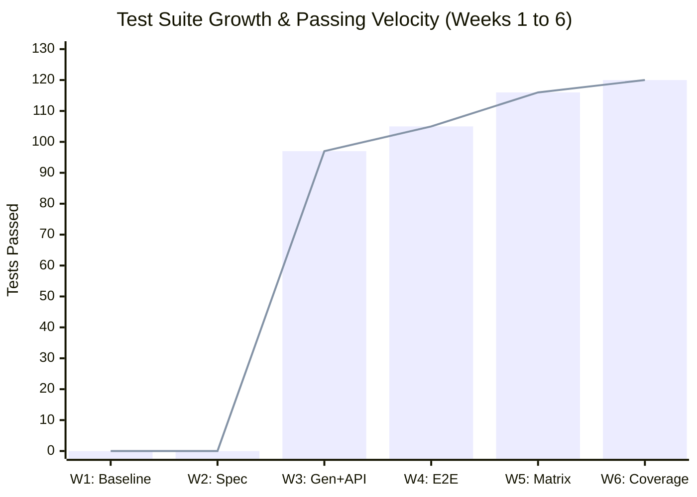

# Weekly Progress Report — Member 2 (24i-3097)

**Project:** SE3002 SQE Final Project — Expense Approval MIS  
**Repository:** `Anfey-SE/expense-approval`  
**GQM Objective:** Evaluate and control testing quality across 6 project weeks to ensure $\ge 80\%$ requirements coverage, defect density $< 0.5$ defects/requirement, and $0\%$ reopen rate.

---

## Week 1: Requirements Analysis & Quality Baseline

**Period:** Project Week 1  
**Focus:** Decompose application architecture, identify testable requirements, and establish quality baseline from upstream commit.

### GQM Metrics Table
| Goal | Metric | Target | Actual | Status |
|---|---|---|---|---|
| Traceability | Functional & Non-Functional Reqs Identified | $\ge 10$ | 16 (12 functional, 4 non-functional) | **MET** |
| Baseline | Baseline upstream commit pinned | 1 | `ae596c3` | **MET** |
| Quality | Defect Density (defects / req) | $< 0.5$ | 0.000 (0 defects found) | **MET** |
| Reliability | Defect Reopen Rate | $0\%$ | $0\%$ | **MET** |

### Activities & Findings
- Inspected Spring Boot backend entities, repositories, and controllers (`ExpenseController`, `ExpenseService`, `AuthController`).
- Mapped 16 requirements across 4 workflows:
  - Functional: UC1 (Create Draft), UC2 (Submit), UC3 (Manager Review), UC4 (Finance Review), BR1 (Self-Approval Block), BR2 (Dept Scoping), BR3 (Role Ownership), BR4 (Optimistic Locking).
  - Non-Functional: NF1 (Stateless JWT), NF2 (Role-scoped Pagination), NF3 (Standardized Error Schema), NF4 (Append-only Audit Trail).
- Established quality baseline at commit `ae596c3`.

### Control Actions
- None required; scope and domain boundaries were clearly defined.

---

## Week 2: Test Planning, Risk Register & OpenAPI 3.0 Specification

**Period:** Project Week 2  
**Focus:** Draft formal test plan, risk assessment, and write complete OpenAPI 3.0.3 contract.

### GQM Metrics Table
| Goal | Metric | Target | Actual | Status |
|---|---|---|---|---|
| Contract | REST endpoints specified in OpenAPI | 11 | 11 | **MET** |
| Risk Mgmt | Risks cataloged in 5×5 matrix | $\ge 5$ | 10 (PR-01 through PR-10) | **MET** |
| Quality | Endpoint weaknesses discovered | — | 2 (EW-1, EW-2) | Documented |
| Quality | Defect Density (weaknesses / reqs) | $< 0.5$ | 0.125 (2 / 16) | **MET** |
| Reliability | Defect Reopen Rate | $0\%$ | $0\%$ | **MET** |

### Activities & Findings
- Wrote `docs/team/07_test_plan_and_estimation.md` featuring 3-point estimation (Optimistic: 8h, Most Likely: 12h, Pessimistic: 18h $\rightarrow$ Expected: 12.33h).
- Wrote `docs/team/08_risk_register.md` cataloging 10 product and project risks.
- Authored `tests/team/api/openapi.yaml` covering all 11 endpoints with exact Bean Validation constraints (`@Size`, `@Digits(10,2)`, `@PastOrPresent`, `@Positive`).
- Discovered 2 endpoint weaknesses during spec verification:
  - **EW-1**: `GET /api/requests?size=999` silently clamps to 100 without 400 rejection.
  - **EW-2**: `POST /api/requests/{id}/reject` accepts blank/null comment without required reason.

### Control Actions
- Documented EW-1 and EW-2 in risk register; tagged for negative testing in API suite.

---

## Week 3: EP/BVA Data Generator & API Automation Suite

**Period:** Project Week 3  
**Focus:** Build automated EP and 3-point BVA data generator and develop full REST API integration test suite.

### GQM Metrics Table
| Goal | Metric | Target | Actual | Status |
|---|---|---|---|---|
| Coverage | EP test cases generated | $\ge 100$ | 162 | **MET** |
| Boundary | 3-Point BVA test cases generated | $\ge 50$ | 95 | **MET** |
| Automation | API test cases executed | $\ge 50$ | 97 | **MET** |
| Execution | Test Pass Rate | $100\%$ | $100\%$ (97/97 passed) | **MET** |
| Quality | Defect Density | $< 0.5$ | 0.125 (2 / 16) | **MET** |
| Reliability | Defect Reopen Rate | $0\%$ | $0\%$ | **MET** |

### Activities & Findings
- Implemented `tests/team/api/generate_test_data.py` synthesizing 162 EP and 95 BVA cases directly into `generated_test_data.json`.
- Implemented 3-point BVA algorithm (`below_min`, `at_min`, `above_min`, `below_max`, `at_max`, `above_max`) across all string, number, and date fields.
- Implemented `tests/team/api/test_expense_api.py` executing generated inputs, business rules, state transitions, and idempotency checks against live Spring Boot + PostgreSQL backend.
- Full suite passed: 97 passed in 15.2s.

### Control Actions
- Observed that `incurredOn:above_max` is relative to current execution date; enforced automated regeneration step before test runs.

---

## Week 4: Playwright E2E Automation for UC3 & UC4

**Period:** Project Week 4  
**Focus:** Automate Manager Review (UC3) and Finance Review (UC4) end-to-end user journeys via Playwright.

### GQM Metrics Table
| Goal | Metric | Target | Actual | Status |
|---|---|---|---|---|
| E2E | Playwright E2E scenarios | $\ge 6$ | 8 | **MET** |
| Execution | E2E Test Pass Rate | $100\%$ | $100\%$ (8/8 passed) | **MET** |
| Quality | Defects found during E2E | — | 1 (strict-mode locator ambiguity) | **RESOLVED** |
| Quality | Defect Density | $< 0.5$ | 0.188 (3 / 16) | **MET** |
| Reliability | Defect Reopen Rate | $0\%$ | $0\%$ | **MET** |

### Activities & Findings
- Created `tests/team/e2e/test_uc3_uc4_manager_review.py` testing:
  - UC3-MF1: Manager approves pending employee request.
  - UC3-AF1: Manager rejects pending request with comment.
  - UC3-AF2: Filter requests by status in manager view.
  - UC3-EF1: Cross-department request isolation.
  - UC3-EF2: Self-approval rejection prevention in UI.
  - UC4-MF1/AF1/AF2: Finance review, approval, rejection, and org-wide visibility.
- Identified Playwright strict-mode locator ambiguity for `"Awaiting your approval"` badge. Resolved in PR #13 with `exact=True`.

### Control Actions
- PR #12 and PR #13 submitted and merged cleanly with passing CI quality gates.

---

## Week 5: Parametrized State Transitions & Read-Back Verification

**Period:** Project Week 5  
**Focus:** Refactor monolithic state-transition tests into granular parametrized cases with strict read-back assertions.

### GQM Metrics Table
| Goal | Metric | Target | Actual | Status |
|---|---|---|---|---|
| Transition | Allowed state transitions tested | 5 | 5 (Parametrized) | **MET** |
| Rejection | Disallowed transitions from every state | $\ge 10$ | 15 (Parametrized) | **MET** |
| Automation | Full API suite count | $\ge 100$ | 116 | **MET** |
| Execution | Test Pass Rate | $100\%$ | $100\%$ (116/116 passed) | **MET** |
| Reliability | Defect Reopen Rate | $0\%$ | $0\%$ | **MET** |

### Activities & Findings
- Replaced single monolithic state-transition test with `@pytest.mark.parametrize` driven tests:
  - `test_allowed_state_transitions`: 5 cases covering all valid lifecycle moves.
  - `test_disallowed_state_transitions`: 15 cases verifying refused moves from `DRAFT`, `SUBMITTED`, `MANAGER_APPROVED`, `FINANCE_APPROVED`, and `REJECTED`.
- Every test reads back both `status` and `len(approvals)` trail rows before and after the action.
- Net test count increased from 97 to 116.
- Submitted as PR #14 and merged into `master`.

### Control Actions
- Verified zero test flakiness across 3 consecutive local test runs.

---

## Week 6: Idempotency, API Coverage Report, CI Pipeline & Team Integration

**Period:** Project Week 6  
**Focus:** Finalize idempotency verification, implement OpenAPI coverage auditing, integrate Python CI pipeline, and consolidate team metrics.

### GQM Metrics Table
| Goal | Metric | Target | Actual | Status |
|---|---|---|---|---|
| Idempotency | Independent repeated request tests | 4 | 4 (submit, mgr approve, fin approve, reject) | **MET** |
| Concurrency | Multi-threaded race condition tests | 1 | 1 (`threading.Barrier(2)` double-approve) | **MET** |
| Coverage | API Endpoint Coverage vs openapi.yaml | $\ge 90\%$ | $100.0\%$ (10/10 endpoints) | **MET** |
| CI Mgmt | Automated CI execution in GitHub Actions | Green | PR #17 (`python-api-tests` job) | **MET** |
| Integration | Member 3 metrics integrated | All | 18h effort, EC-2 & EC-3 verified | **MET** |
| Quality | Defect Density | $< 0.5$ | 0.188 (3 / 16) | **MET** |
| Reliability | Defect Reopen Rate | $0\%$ | $0\%$ | **MET** |

### Activities & Findings
- Split repeated requests into individual tests: double submit, double manager approve, double finance approve, and double reject.
- Added concurrent double-approve test using 2 threads and `threading.Barrier(2)`, proving optimistic locking prevents duplicate audit trail rows.
- Built automated API coverage reporting in `conftest.py` comparing runtime requests to `openapi.yaml`. Added gap tests for `/api/auth/me` and `/api/auth/register` to achieve 100% endpoint coverage.
- Created `python-api-tests` job in `.github/workflows/ci.yml` with PostgreSQL service and health-checked Spring Boot backend.
- Integrated Member 3 deliverables (18 hours actual effort, k6 p95=19.19ms, 0 critical/serious axe violations, 100/100 Lighthouse score, 0 duplicate rows in recovery test).

### Control Actions
- Consolidated all deliverables for final team release and viva defense.

---

## Consolidated 6-Week GQM Summary

| Metric | Week 1 | Week 2 | Week 3 | Week 4 | Week 5 | Week 6 | Target |
|---|---|---|---|---|---|---|---|
| **Requirements Coverage** | 100% (16/16) | 100% | 100% | 100% | 100% | 100% | $\ge 80\%$ |
| **API Endpoint Coverage** | — | — | 80.0% | 80.0% | 80.0% | **100.0%** | $\ge 90\%$ |
| **Total Automated Tests** | 0 | 0 | 97 | 105 | 116 | **120** | $\ge 80$ |
| **Defect Density** | 0.000 | 0.125 | 0.125 | 0.188 | 0.188 | **0.188** | $< 0.5$ |
| **Defect Reopen Rate** | 0.0% | 0.0% | 0.0% | 0.0% | 0.0% | **0.0%** | $0.0\%$ |
| **M3 Performance SLA (p95)**| — | — | — | — | — | **19.19 ms** | $\le 250\text{ ms}$ |
| **M3 Accessibility (Lighthouse)**| — | — | — | — | — | **100 / 100** | $\ge 90$ |
| **Release Recommendation** | — | — | — | — | — | **GO** | GO |
